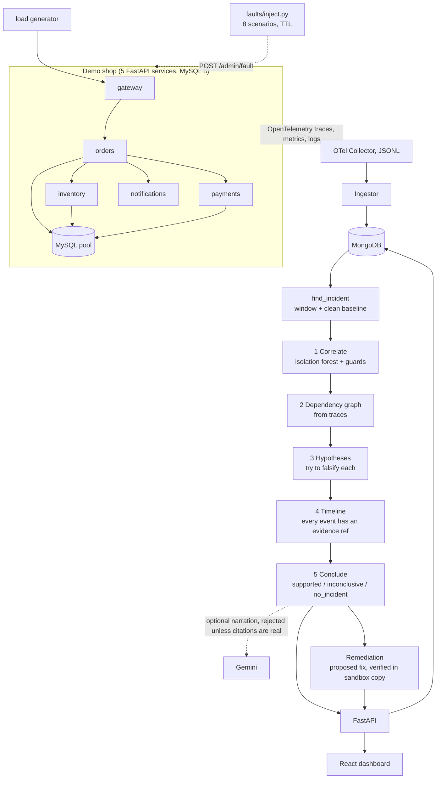

# RootCause AI: end-to-end flow

## Demo script (about 3 minutes)

1. `make up` and open http://localhost:8000. No Docker: `python -m rootcause.devstack up`, then `make serve`.
2. `python faults/inject.py run slow_notifications_trap --duration 90`. Orders looks slow, but notifications is the cause.
3. Click **Investigate latest incident** (or `python -m rootcause investigate`).
4. Show, in order: the diagnosis and confidence; the dependency graph with the root cause highlighted; the rejected `orders / latency` hypothesis and why; the timeline, where each row opens its raw log or span; the remediation card (`verified`, proposed, not applied).
5. `make eval-live` for the benchmark table.

## Interview talking points

- The LLM never decides: diagnosis is computed from telemetry, and prose is accepted only if every citation is real.
- It tries to falsify hypotheses, which is how it avoids blaming the busiest service.
- Three real-telemetry failures found and fixed (blips in the baseline, harness cooldown, single noisy bucket), each now a regression test.
- Why MySQL for the shop, MongoDB for telemetry, no graph DB.
